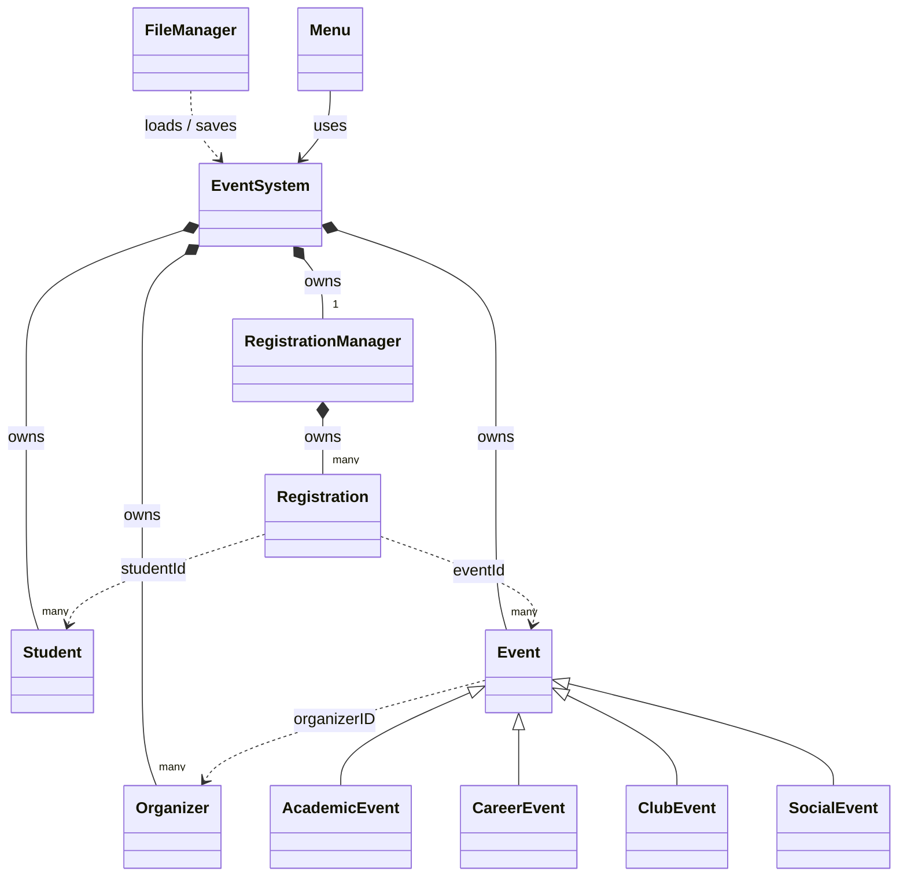

# Technical Design Document

This document explains how the Campus Event Management System is designed and why we made the choices we did. The UML class diagram in this folder shows the same design in diagram form.

## 1. Major Classes and Responsibilities

We split the program so that each class has one clear job. No single class does all the work.

| Class | Responsibility | Does NOT do |
|---|---|---|
| `Student` | Stores one student's ID, name, email and major. Displays itself. | Know which events it is registered for |
| `Organizer` | Stores one organizer's ID, name, email and department. Displays itself. | Store its own list of events |
| `Event` | Stores the fields every event has and declares the virtual `displayDetails()` | Know who is registered |
| `AcademicEvent`, `CareerEvent`, `ClubEvent`, `SocialEvent` | Add the fields that only one type of event has, and override `displayDetails()` to print them | |
| `Registration` | Connects one student ID to one event ID, with a date and an active flag | Check any rules |
| `RegistrationManager` | Owns every `Registration`. Enforces the rules: no duplicates, no going over capacity, can only cancel an active registration. Answers questions like "how many people are in this event?" | Print anything to the screen |
| `EventSystem` | Owns all students, organizers and events. Finds objects by ID, displays them, runs reports, and turns registration results into messages for the user | Read or write files |
| `FileManager` | Reads and writes the four data files and rebuilds the objects on startup | Make decisions about registration rules |
| `Menu` | Shows the menu, reads and checks the user's input, and calls `EventSystem` for each option | Store any data or apply any rules |
| `main.cpp` | Starts the program: loads the data, runs the `Menu`, saves the data on exit | Contain any application logic |

## 2. Relationships Between Classes



**Who owns what:**

- `EventSystem` owns every `Student`, `Organizer` and `Event`. They are stored as `vector<unique_ptr<...>>`. When `EventSystem` is destroyed, all of them are freed automatically.
- `EventSystem` owns exactly one `RegistrationManager` as a normal member variable.
- `RegistrationManager` owns every `Registration`, stored by value in a `vector<Registration>`.
- `FileManager` owns nothing. It is handed an `EventSystem` by reference when loading or saving.
- `Menu` owns nothing either. It holds a reference to the `EventSystem` that `main` created, so the menu and the file loading/saving all work on the same data.

**How objects refer to each other:**

- An `Event` stores its organizer's **ID** (a string), not a pointer to the `Organizer`.
- A `Registration` stores a student **ID** and an event **ID**, not pointers.
- When another class needs the real object, it asks `EventSystem` with `findStudent(id)`, `findEvent(id)` or `findOrganizer(id)`. These return a plain pointer (or `nullptr` if not found). The pointer lets the caller use the object without taking ownership of it.

## 3. Inheritance Hierarchy

```
Event
 ├── AcademicEvent   (department, speaker)
 ├── CareerEvent     (companyName, recruiterName)
 ├── ClubEvent       (clubName)
 └── SocialEvent     (theme, foodProvided)
```

Every event has an ID, name, description, date, time, location, organizer and capacity, so those go in the base `Event` class. Each subclass only adds what is special about that type of event. For example, only a career event has a recruiter.

These are true **is-a** relationships. A `CareerEvent` *is an* `Event`: it can be stored in the same list, registered for the same way, and counted toward capacity the same way. We did not make subclasses just to show inheritance. Each one has its own data and its own way of displaying itself.

The base class fields are `private`. Subclasses use the public getters, so a subclass can't accidentally change the event's ID or capacity.

`Event` has a `virtual` destructor. This matters because events are deleted through a `unique_ptr<Event>`. Without a virtual destructor, deleting a `CareerEvent` through an `Event` pointer would only run the `Event` part of the destructor.

## 4. Use of Composition

Composition is used where one object is made up of others and controls their lifetime:

- **`EventSystem` has-a list of students, organizers and events.** It creates them, stores them and destroys them. We used composition and not inheritance here because `EventSystem` is not a kind of student or event. It is a container that manages them.
- **`EventSystem` has-a `RegistrationManager`.** We moved all registration logic into its own class instead of putting it directly in `EventSystem`. This keeps `EventSystem` from turning into a "God class," and it let one teammate build the registration rules on their own branch without touching anyone else's files.
- **`RegistrationManager` has-a list of `Registration` objects.**

## 5. Use of Polymorphism

`Event` declares:

```cpp
virtual void displayDetails() const;
```

and each subclass overrides it. For example, `CareerEvent::displayDetails()` first calls `Event::displayDetails()` to print the shared fields, then prints the company and recruiter.

`EventSystem` stores all events in one list of `unique_ptr<Event>`. When it displays them it just writes:

```cpp
event.displayDetails();
```

C++ looks at the real type of the object at runtime and runs the right version. The same line prints a speaker for an academic event and a club name for a club event.

**Why this helps:**

- View Events and Search Events both just call `displayDetails()`. Neither one needs an `if` or `switch` on the event type.
- Adding a new event type, such as a `SportsEvent`, means writing the new class with its own `displayDetails()`. The display, search and report code does not change.

**One place we did not use polymorphism:** `FileManager::saveEvents` uses `dynamic_cast` to work out each event's type, so it knows which extra fields to write. A cleaner design would give each event class a virtual function that returns its own save record. We kept `dynamic_cast` because it keeps all the file format details inside `FileManager`, where the persistence work was being done. The tradeoff is that adding a new event type means updating `FileManager` too.

## 6. Important Design Decisions and Tradeoffs

### Events store an organizer ID, not a pointer to the Organizer

| Option | Pros | Cons |
|---|---|---|
| Store a copy of the `Organizer` | Simple | Duplicates data. If the organizer's email changes, every copy goes out of date |
| Store an `Organizer*` | Fast lookup | The pointer could be left dangling if the organizer were removed. Pointers also can't be written to a file, so we'd still need the ID for saving |
| **Store the organizer ID (chosen)** | No duplicated data, no dangling pointers, and it can be saved to a file as-is | Finding the organizer needs a search through the list |

To make sure the ID always points to a real organizer, `EventSystem::addEvent()` refuses any event whose organizer ID does not exist.

### Registrations store IDs, and are owned by RegistrationManager

The assignment asks us to view registrations from both directions: a student's events and an event's students. We considered giving every `Student` a list of events and every `Event` a list of students. That would store the same relationship twice, and the two lists could get out of sync.

Instead, every registration is stored exactly once, in `RegistrationManager`. Both directions are answered by searching that one list:

- `getEventIdsForStudent(studentId)`
- `getStudentIdsForEvent(eventId)`

The tradeoff is a linear search each time. For the size of a campus event list, this is fast enough.

### Canceling a registration keeps the record

`cancelRegistration` does not delete the `Registration`. It sets `active` to false. Canceled registrations are ignored when counting attendees or checking for duplicates. If the student registers again later, the old record is reactivated with the new date. This keeps a history of cancellations and avoids duplicate records for the same student and event.

### RegistrationManager returns a result instead of printing

`RegistrationManager::registerStudent` returns a `RegistrationResult` enum (`Success`, `StudentNotFound`, `EventNotFound`, `DuplicateRegistration`, `EventFull`, `InvalidDate`). `EventSystem` turns that result into a message for the user. Keeping the rules separate from the screen output makes the registration logic easier to test and reuse.

### unique_ptr for ownership

Events have to be stored as pointers so that polymorphism works: a `vector<Event>` would cut off the subclass part of each event. We used `unique_ptr` instead of raw `new`/`delete` so memory is freed automatically and there is exactly one clear owner, `EventSystem`. Other classes only get a plain, non-owning pointer from `findEvent()` and friends.

### Events don't store how many people are registered

`Event` only stores its capacity. It has no "registered count" field. When a report needs the number of registered students or spaces remaining, `EventSystem` asks `RegistrationManager` with `getRegistrationCount(eventId)` and works it out from the capacity. Keeping the count in one place means it can never disagree with the actual list of registrations. It also keeps `Event` independent of the registration system.

## 7. How Data Is Stored and Reconstructed

Data is stored in four text files in `data/`, one record per line, with fields separated by `|`:

```
students.txt       S1001|Maria Lopez|mlopez@student.ivc.edu|Computer Science
organizers.txt     O1|Karen Mitchell|kmitchell@ivc.edu|Engineering Department
events.txt         ACADEMIC|E101|Introduction to Robotics|...|O1|30|Engineering|Dr. Alan Reyes
registrations.txt  S1001|E101|2026-10-01|1
```

**Saving event types.** The first field of each event line is a type tag (`ACADEMIC`, `CAREER`, `CLUB`, `SOCIAL`), followed by the shared fields and then the type-specific fields. Without the tag, the loader would have no way to know which subclass to create.

**Reconstruction on startup.** The files are loaded in this order:

1. **Organizers**: nothing depends on anything else yet
2. **Students**
3. **Events**: `addEvent` checks that each event's organizer exists, so organizers must already be loaded. The type tag decides whether to build an `AcademicEvent`, `CareerEvent`, `ClubEvent` or `SocialEvent`, which is then handed to `EventSystem` as a `unique_ptr<Event>`.
4. **Registrations**: rebuilt last, from the stored student ID and event ID

Because relationships are stored as IDs, no extra linking step is needed after loading. The IDs in the file are the same IDs used at runtime. This is a big reason we chose IDs over pointers: a pointer address from a previous run would mean nothing after a restart.

**Error handling while loading:**

- A missing file is not an error. The program just starts with no data of that kind.
- A line with the wrong number of fields, an unknown type tag, or a capacity that isn't a number is skipped with a message. The rest of the file still loads.
- Duplicate IDs and events with an unknown organizer are rejected by the same `addStudent` and `addEvent` checks the menu uses.

**Saving.** All four files are rewritten when the user exits through the menu.

## 8. How the Team Divided the Project

We agreed on the class names and main function signatures first. That let each person work on a separate feature branch without waiting on the others.

| Area | Team member | Branch |
|---|---|---|
| `Student`, `EventSystem` storage, registration integration, reports, search | Mohammad Bahramand | `feature/student-management`, `feature/organizer-storage-clean`, `feature/event-storage`, `feature/registration-storage`, `feature/reports`, `feature/event-search` |
| `Organizer`, `Menu` class, UML diagram | Devon Nghiem | `feature/organizer`, `feature/MainMenu` |
| `Event`, `AcademicEvent`, `ClubEvent` | viav0 | `feature/event-management` |
| `CareerEvent`, `SocialEvent` | Mahir Altuntas | `feature/event-management` |
| `Registration`, `RegistrationManager` | Abdullah Shafi | `feature/registration` |
| `FileManager`, persistence, sample data, documentation | Jeremy Huang | `feature/file-storage`, `feature/loadall`, `feature/sample-data`, `feature/docs` |

Each feature was merged into `main` through a Pull Request so the rest of the team could review it.

## 9. Technical Challenges and How We Solved Them

**Rebuilding the right event type from a file.** A text file only holds strings, but on startup the program has to recreate an `AcademicEvent` vs. a `CareerEvent`. We solved this by writing a type tag as the first field of each event line and checking the number of fields for that type before building the object.

**Load order.** Events need their organizer to exist, and registrations need their student and event. The files therefore have to be loaded in a fixed order (organizers → students → events → registrations). `FileManager` has `loadAll()` and `saveAll()` functions that follow this order.

**Integrating parallel work.** Some files were first uploaded to the wrong folders. For example, `SocialEvent.h` was placed in `src/` and the registration files were added at the top level, so they had to be moved into `include/` and `src/`. The menu branch also had to merge `main` into itself more than once as other features landed. Agreeing on the folder layout early and pulling `main` often made later merges smoother.

**Keeping logic out of `main.cpp`.** Our first working version put a lot of code in `main.cpp`: searching events, finding an organizer's events, and the load/save order. The assignment says `main.cpp` should mainly start and coordinate the program. We moved each piece into the class it belongs to. Search and "events by organizer" went into `EventSystem` (`searchEventsByName`, `displayEventsByOrganizer`). The load/save order went into `FileManager` (`loadAll`, `saveAll`). The menu itself moved into a new `Menu` class. `main.cpp` went from over 300 lines to about 30.